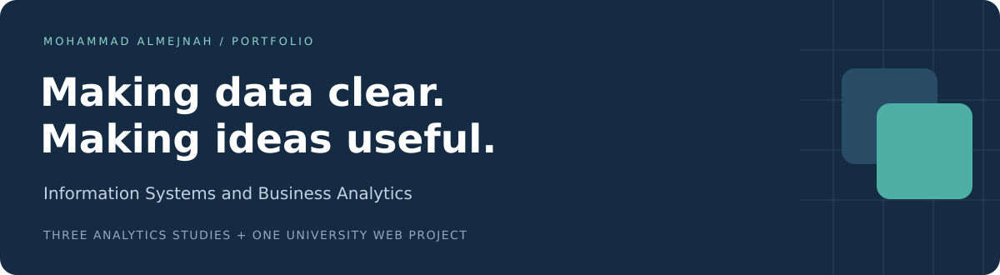
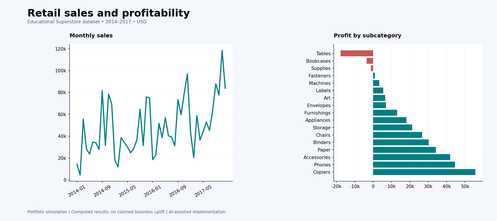

# Mohammad Almejnah
**Information Systems and Business Analytics student**  
Imam Abdulrahman Bin Faisal University · Dammam

I am interested in using data to understand business problems and communicate useful findings. This portfolio brings together four projects: retail profitability, customer behavior, Saudi population trends, and a university task-planning website.

My learning focus is **Excel, SQL, Power BI, and Python/pandas**, alongside the web fundamentals used in Smart Task. I am seeking a **16-week co-op placement starting 17 January 2027** to develop these foundations through practical work and collaboration.

[Superstore](#01--superstore-sales--profitability) · [Customer RFM](#02--customer-rfm-segmentation) · [Saudi Population](#03--saudi-population-analysis) · [Smart Task](#04--smart-task)

---

## 01 · Superstore Sales & Profitability
**Retail analytics · Python/pandas · SQL · Power BI project files**

### When strong sales do not mean strong profit
This project explores an educational retail dataset to understand which products generate revenue, which lose money, and where further investigation would be useful.

The workflow prepares order data, checks dates and numeric values, loads the cleaned records into SQLite, and compares sales, profit, discounts, and regional performance. Results are presented as charts, CSV tables, and a prepared Power BI model.

| Analysis scope | Main finding |
|---|---|
| 9,994 order lines · 5,009 orders · 2014–2017 | Tables recorded **$17,725.48 in losses** despite contributing sales. |

**Why it matters:** The analysis illustrates why product decisions need both revenue and profit measures. Reviewing discounts and product mix would be a next step; no business improvement is claimed.

[**Explore the project →**](sales-profitability/) · [SQL analysis](sales-profitability/implementation/sql/) · [Results](sales-profitability/implementation/outputs/subcategories.csv)

---

## 02 · Customer RFM Segmentation
**Customer analytics · Python/pandas · SQL · Power BI project files**

### Different customers need different follow-up
Using the same Superstore sample from a customer perspective, this project groups customers by **Recency** (last purchase), **Frequency** (number of orders), and **Monetary value** (total spending).

The workflow summarizes transactions by customer, calculates RFM scores, and assigns each customer to one of five rule-based segments. The resulting reports make it easier to compare purchasing behavior and propose follow-up ideas.

| Analysis scope | Main finding |
|---|---|
| 793 customers · 5 segments | The Champions segment accounts for **33.4% of historical sales**. |

**Why it matters:** Segmentation provides a more focused starting point for customer engagement than treating everyone alike. These groups describe past behavior; they are not a prediction of future purchases.

[**Explore the project →**](customer-rfm/) · [RFM queries](customer-rfm/implementation/sql/) · [Segment results](customer-rfm/implementation/outputs/segments.csv)

---

## 03 · Saudi Population Analysis
**Saudi public data · Python/pandas · SQL · Power BI project files**

### A clearer view of regional population change
This project uses an official GASTAT historical dataset to compare population across Saudi Arabia's regions between 2010 and 2022.

The workflow standardizes population values, separates national totals from regional observations, and checks the region–year records before calculating growth and regional shares.

| Analysis scope | Main finding |
|---|---|
| 13 regions · 13 years · 169 observations | The three largest regions held **67.6% of the 2022 population**. |

**Why it matters:** Regional comparisons help frame questions about demand and service coverage. The figures describe a historical series and would need current supporting data for a real planning decision.

[**Explore the project →**](saudi-population/) · [Data attribution](saudi-population/implementation/docs/SOURCE.md) · [Regional results](saudi-population/implementation/outputs/regions_2022.csv)

---

## 04 · Smart Task
**University web project · HTML · CSS · JavaScript · localStorage**

### Turn a daily to-do list into a practical plan
Smart Task is my university front-end prototype for keeping daily tasks, priorities, and goals together. Users can add a task, describe why it matters, choose a priority, and track completion.

| Plan | Manage | Keep track |
|---|---|---|
| Add a title, description, and due preference. | Edit, delete, and mark tasks complete. | Retain tasks in the same browser using localStorage. |
| Choose a priority manually. | Connect a task to a goal and a reason. | Review saved tasks as cards. |

**Work represented:** Four connected pages—Home, Tasks, About, and Support—with separate HTML, CSS, and JavaScript files. The project provides practice in form handling, page styling, user interactions, and browser storage.

[**Explore the project →**](smart-task/) · [Task page source](smart-task/app/tasks.html) · [JavaScript implementation](smart-task/app/js/app.js)

---

## Tools in context

| Area | How it appears in the portfolio |
|---|---|
| Python / pandas | Preparing datasets, validating values, and generating analysis outputs. |
| SQL / SQLite | Summarizing sales, calculating customer metrics, and comparing regions and years. |
| Power BI / DAX | Prepared report and model files with measures for reviewing the analysis. |
| HTML / CSS / JavaScript | Structuring, styling, and connecting the Smart Task interface. |
| Communication | Explaining the question, method, findings, and scope of each project. |

## Explore the files
Each project has its own overview, implementation, and supporting files. Start with the **project page** for the story, then open the **results** or **code** for detail.

[Repository guide](docs/PORTFOLIO_GUIDE.md) · [Project scope and attribution](docs/PROJECT_SCOPE.md)

**Project context:** The three analytics studies are educational and developed with AI assistance. Their previews are generated in Python from the results, not captured from Power BI. Power BI files are included, but Desktop refresh/render and Service publication remain unverified. Smart Task is a university front-end prototype with manual priorities and local browser storage.

نبذة بالعربي

أنا محمد المجنه، طالب نظم المعلومات وتحليلات الأعمال بجامعة الإمام عبدالرحمن بن فيصل. يجمع هذا الملف أربعة مشاريع: تحليل مبيعات وأرباح متجر، وتقسيم العملاء حسب سلوك الشراء، وتحليل بيانات سكان المملكة، وموقع Smart Task لتنظيم المهام.

لكل مشروع شرح للفكرة ومصدر البيانات وخطوات العمل والنتائج، مع روابط للملفات الداعمة. أهتم بتحليل البيانات وعرضها بوضوح، وأبحث عن تدريب تعاوني يتيح لي تطوير مهاراتي والعمل مع فريق.

