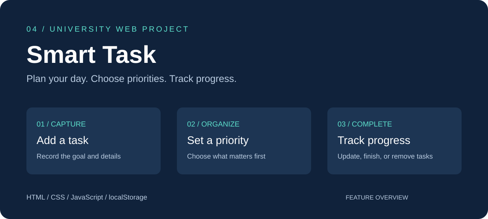

<b>Four projects. Clear questions. Work you can explore.</b> Information Systems and Business Analytics · Imam Abdulrahman Bin Faisal University

<a href="sales-profitability/">Sales Analysis</a> · <a href="customer-rfm/">Customer Segmentation</a> · <a href="saudi-population/">Saudi Population</a> · <a href="smart-task/">Smart Task</a>

## Selected work

<table>
<tr>
<td width="50%" valign="top">
<h3>01 · Superstore Sales Analysis</h3>

Which products sell well but lose money?

Prepared retail data, compared sales and profit, and highlighted the loss-making Tables subcategory.

<b>Python · SQL · Power BI files</b>

<a href="sales-profitability/"><b>Explore the project →</b></a>
</td>
<td width="50%" valign="top">
<h3>02 · Customer RFM Segmentation</h3>

How can purchase history guide customer follow-up?

Organized 793 customers into five groups based on purchase recency, frequency, and value.

<b>Python · SQL · Power BI files</b>

<a href="customer-rfm/"><b>Explore the project →</b></a>
</td>
</tr>
<tr>
<td width="50%" valign="top">
<h3>03 · Saudi Population Analysis</h3>

How did population change across Saudi regions?

Prepared official historical data and compared 13 regions over 2010–2022.

<b>Python · SQL · Power BI files</b>

<a href="saudi-population/"><b>Explore the project →</b></a>
</td>
<td width="50%" valign="top">
<h3>04 · Smart Task</h3>

How can daily tasks become easier to organize?

A university website with task management, manual priorities, completion tracking, and browser storage.

<b>HTML · CSS · JavaScript</b>

<a href="smart-task/"><b>Explore the project →</b></a>
</td>
</tr>
</table>

## About me

I am **Mohammad Almejnah**, a BIS student based in Dammam, interested in Excel, SQL, Power BI, and Python/pandas. I am seeking a **16-week co-op placement starting 17 January 2027**.

Each project page contains a short overview, work covered, outcomes, and links to the supporting files.

<b>Project context and technical guide</b>

The three analytics projects are educational simulations developed with AI assistance. Their images are Python-rendered previews, not Power BI screenshots. Power BI Desktop refresh/render and online publication remain unverified. Smart Task is a university front-end prototype. Findings describe sample or historical data, not commercial results.

[Repository guide and run instructions](docs/PORTFOLIO_GUIDE.md)

