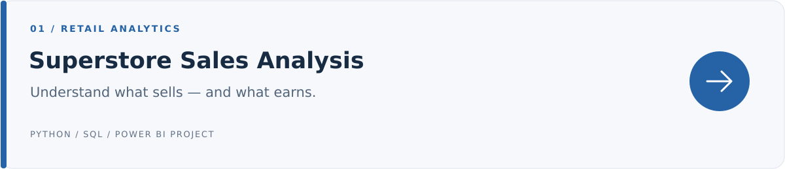
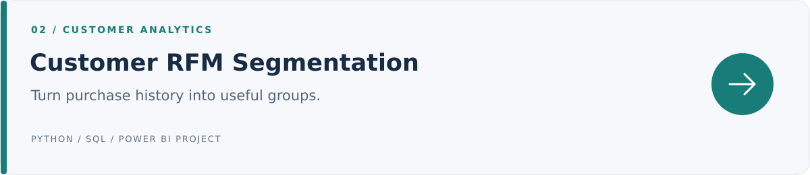

**Mohammad Almejnah** · BIS student · Imam Abdulrahman Bin Faisal University · Dammam

I enjoy turning data into clear reports and building practical tools. These four projects show my learning in data preparation, analysis, reporting, and web development.

**Co-op availability:** 17 January 2027 · 16 weeks

## Selected projects

Identified Tables as a loss-making product group. [**View project →**](sales-profitability/)

Organized 793 customers into five segments. [**View project →**](customer-rfm/)

Compared 13 regions across the 2010–2022 historical series. [**View project →**](saudi-population/)

A browser-based prototype for planning and tracking daily tasks. [**View project →**](smart-task/)

---

**Learning focus:** Excel · SQL · Power BI · Python/pandas  
**Web foundations:** HTML · CSS · JavaScript

The analytics projects are educational and AI-assisted; Smart Task is my university front-end prototype.

[How to explore the files](docs/PORTFOLIO_GUIDE.md) · [Project scope](docs/PROJECT_SCOPE.md)

نبذة بالعربي

أنا محمد المجنه، طالب نظم المعلومات وتحليلات الأعمال. يعرض هذا الملف أربعة مشاريع في تحليل المبيعات، وتقسيم العملاء، والسكان في المملكة، وتطوير موقع لتنظيم المهام. افتح أي مشروع للاطلاع على الفكرة وخطوات العمل والنتائج.

