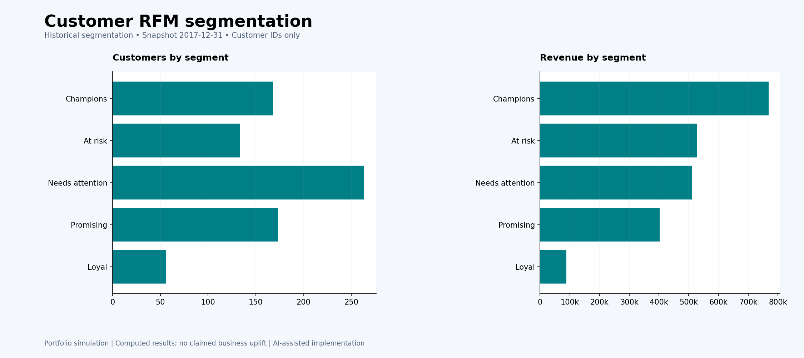

# Customer RFM Segmentation

[← Back to all four projects](../README.md)

**How can customers be grouped by their buying activity?**

A learning project that turns purchase history into simple customer groups to support different follow-up ideas.

## Tools and data

**Tools:** Python/pandas · SQLite/SQL · Power BI project files · DAX

**Data:** The same historical Superstore sample used in the sales project. [Source details](docs/SOURCE.md)

## Work covered

- Summarized purchases for each customer.
- Calculated recency (how recently they bought), frequency (how often), and monetary value (how much they spent).
- Applied clear grouping rules and prepared segment summaries and report files.

This is an educational portfolio simulation developed with AI assistance.

## Main outcome

793 customers were grouped into five segments. These groups suggest different engagement approaches; no marketing campaign or revenue improvement was measured.

## Evidence

[View the result table](outputs/segments.csv) · [Data quality checks](outputs/quality_report.json)

## Preview

*Python-rendered preview, not a Power BI screenshot. Power BI Desktop refresh/render and online publication remain unverified.*

## Explore the work

- [SQL queries](sql/)
- [Analysis results](outputs/)
- [Power BI files](powerbi/) · [Opening instructions](powerbi/OPEN_IN_POWER_BI.md)
- [Python implementation](src/) · [Run entry point](analysis.py)
- [Method and setup](docs/TECHNICAL_NOTES.md)

## بالعربي

تقسيم العملاء حسب آخر شراء، وعدد الطلبات، وقيمة المشتريات. الهدف فهم اختلاف العملاء واقتراح أسلوب متابعة مناسب لكل مجموعة.

---
[← Portfolio](../README.md) · [How to explore this repository](../docs/PORTFOLIO_GUIDE.md)
