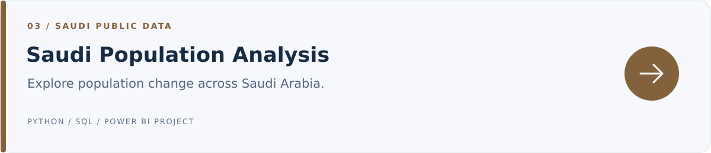
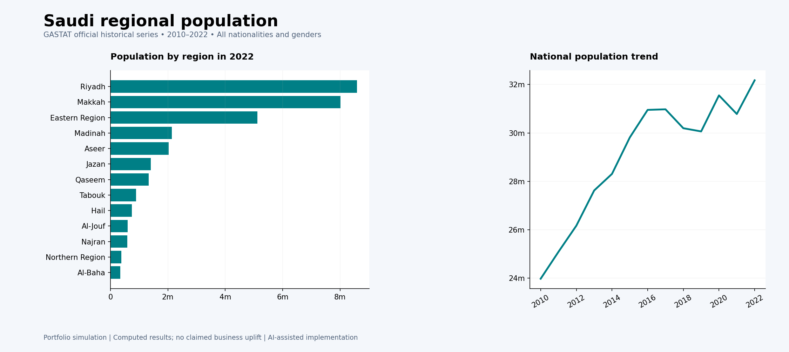

[← Portfolio home](../README.md) · [Data source](implementation/docs/SOURCE.md) · [Technical notes](implementation/docs/TECHNICAL_NOTES.md)



# Saudi Population Analysis
**Exploring the regional picture behind national totals.**

Python/pandas · SQLite/SQL · Power BI project files · DAX  
Educational portfolio study · AI-assisted implementation

## The question
How was Saudi Arabia's population distributed across regions, and how did it change between 2010 and 2022?

## Data and starting point
The **General Authority for Statistics (GASTAT)** official historical population series, exported from its public Tableau view. The source snapshot covers **2010–2022**, with all genders and nationalities included. [Source and attribution →](implementation/docs/SOURCE.md)

## From data to report

| Stage | Work covered |
|---|---|
| **1. Read the official dataset** | Use the documented GASTAT CSV snapshot and retain region, year, and population values. |
| **2. Standardize the figures** | Convert comma-separated population strings into integer counts suitable for analysis. |
| **3. Separate totals from detail** | Exclude the 13 national aggregate rows from the regional fact table to avoid double counting. |
| **4. Validate regional coverage** | Check the 169 region–year observations for repeated keys and reconcile regional sums with national totals. |
| **5. Compare regions and years** | Calculate regional shares and historical growth, then prepare charts, result tables, and Power BI model/report files. |

## Analysis preview



*This preview is generated in Python from the analysis outputs. It is not a Power BI screenshot.*

## Findings
| Measure | Result |
|---|---:|
| Regions | 13 |
| Years in the series | 13 |
| Region–year observations | 169 |
| Population in the 2022 regional total | 32,175,224 |
| Three largest regions' share in 2022 | 67.6% |
| Growth from 2010 to 2022 | 34.2% |

**Population is concentrated in a small number of regions.** This historical comparison can help frame questions about demand and service coverage. A real location or expansion decision would also require current demand, income, competition, and operating-cost data.

[2022 regional comparison](implementation/outputs/regions_2022.csv) · [National trend](implementation/outputs/national_trend.csv) · [Growth results](implementation/outputs/growth.csv)

## An important analysis decision
Population is **not additive across years**. Headline totals use the latest selected year rather than summing the entire series. National aggregate rows are checked separately from regional records, with small source rounding differences recorded.

## Skills practiced
This study provides practice in working with official Saudi data, checking geographic and time coverage, avoiding double counting, and presenting historical trends with the correct context.

## Explore the work

| File area | What you can review |
|---|---|
| [Python implementation](implementation/src/) | Data preparation and report-generation modules. |
| [SQL queries](implementation/sql/) | Calculations and summaries behind the findings. |
| [Computed outputs](implementation/outputs/) | Result tables and prepared model data. |
| [Power BI files](implementation/powerbi/) | Report definitions, data model, and DAX measures. |
| [Quality report](implementation/outputs/quality_report.json) | Data checks and preparation decisions. |
| [Validation checks](implementation/tests/) | Checks for output consistency. |

## Run it locally
Download the repository and open a terminal in `saudi-population/implementation`:

```bash
pip install -r requirements.txt
python analysis.py
python -m unittest discover -s tests
```

The pipeline generates the analysis outputs and an offline `dashboard.html`. Open that generated HTML file locally to explore the report. For Power BI, follow the [opening instructions](implementation/powerbi/OPEN_IN_POWER_BI.md).

## Project scope
This is an educational, AI-assisted study. The findings describe the supplied sample or historical series; they do not demonstrate a commercial improvement. Power BI definitions are included, but Desktop refresh/render and Service publication remain unverified.

<details>
<summary>شرح المشروع بالعربي</summary>

يعرض المشروع توزيع السكان بين مناطق المملكة وتغيره بين 2010 و2022. شمل العمل تجهيز بيانات الهيئة العامة للإحصاء، وفصل الإجمالي الوطني عن بيانات المناطق لمنع التكرار، ثم حساب النمو ونسب المناطق.

</details>

---
[← Explore all four projects](../README.md)
